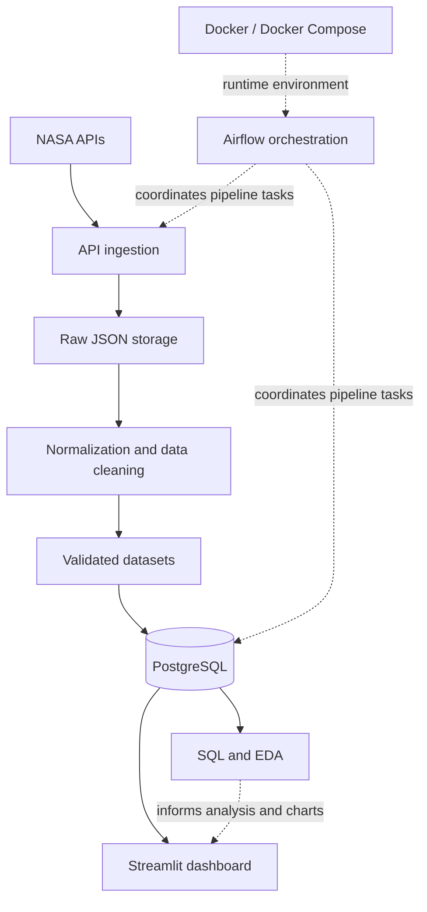

# 🚀 NASA Space Explorer

An end-to-end data engineering project that collects, processes, stores, and explores NASA astronomy media metadata.

**Final group project · Topics in Data Engineering · MS in Machine Learning & Data Science · Northwestern University**

**Dashboard:** [NASA Space Explorer](https://nasa-explorer-mlds.streamlit.app/)

## Overview

NASA Space Explorer combines data engineering, database management, workflow automation, exploratory data analysis (EDA), and interactive visualization. The project uses metadata from NASA's public APIs to build a reproducible pipeline and a user-facing dashboard.

| Data source | Purpose |
| --- | --- |
| NASA Astronomy Picture of the Day (APOD) | Featured astronomy media, descriptions, dates, and credits |
| NASA Image & Video Library | Searchable image metadata, titles, dates, NASA identifiers, image links, and keywords |

The project collects metadata and image URLs, rather than downloading the full-resolution media archive.

### Project objectives

- Collect NASA media metadata through API integration.
- Standardize and validate data for consistent downstream use.
- Store and query structured records in PostgreSQL.
- Coordinate repeatable pipeline tasks using Apache Airflow and Docker.
- Analyze patterns and data quality through EDA.
- Present results through an interactive Streamlit dashboard.

## Architecture and workflow



| Stage | Summary |
| --- | --- |
| Extract | Query NASA APIs, handle pagination and retries, and save source responses. |
| Transform | Flatten nested JSON, standardize fields, and create consistent records. |
| Validate & clean | Check data quality, handle missing values, and remove duplicate image records. |
| Load | Prepare and load structured datasets into PostgreSQL. |
| Orchestrate | Coordinate pipeline execution using Airflow and containerized services. |
| Analyze & visualize | Explore the data using SQL/EDA and present insights in Streamlit. |

Airflow coordinates the relevant processing stages; it is not a data transformation that runs after the dashboard. The diagram represents the overall system architecture, not a claim that every integration path has been independently tested.

## Data coverage

The Image & Video Library collection covers nine search topics: **Mercury, Venus, Earth, Mars, Jupiter, Saturn, Uranus, Neptune, and Galaxy**.

**Collection update:** Earth and Mars have since been extended beyond the earlier 100-page collection cap, and the team reports that both searches have now been fully fetched. Consequently, the earlier **32,695 collected records / 31,525 unique images** describe a previous processing run, not the current full dataset. Updated collection totals, deduplicated counts, and quality metrics should be taken from the latest generated reports after reprocessing.

The earlier search snapshot reported **80,811 combined results** across nine topic queries. This is a sum of keyword-search hits, not a count of unique NASA images; searches can overlap and NASA's reported totals can change. The team should verify the latest per-topic counts against the saved raw files and API responses before reporting final statistics.

**Interpretation note:** Keyword matches do not always indicate a planet as a scientific subject (for example, “Mars” can refer to a place and “Saturn” to a rocket). Counts from keyword searches should not be presented as unbiased measures of NASA exploration activity.

## Technology stack

| Area | Tools |
| --- | --- |
| Programming and data processing | Python, Requests, Pandas |
| Data formats | JSON, JSONL |
| Database and querying | PostgreSQL, SQL |
| Orchestration and infrastructure | Apache Airflow, Docker, Docker Compose |
| Analysis and visualization | Jupyter, Plotly, Streamlit |
| Development and testing | Git, GitHub, Conda, Pytest |

## Getting started

### Local setup

From the repository root:

```bash
git clone https://github.com/nasa-space-explorer-team/400_Data-engineering_project.git
cd 400_Data-engineering_project

conda env create -f environment.yml
conda activate nasa-space-explorer
python -m pip install -r requirements.txt

cp .env.example .env
# Add local configuration values to .env; never commit real credentials.
```

Some features require access to a configured PostgreSQL instance, container services, or application secrets. Consult the relevant service configuration in the repository.

### Run local data processing

```bash
# Collect NASA Image Library metadata
python -m src.apis.collect_planets

# Normalize, inspect, and export the collected metadata
python -m src.processing.process_nasa_data
python -m src.processing.data_quality_report
python -m src.processing.export_clean_data

# Run project tests
python -m pytest tests/ -v
```

**Before recollecting:** Check the collector's current page limit, resume behavior, and configuration. The commands show the local processing entry points and do not by themselves deploy the complete Airflow/PostgreSQL/Streamlit stack.

## Repository structure

```text
400_Data-engineering_project/
├── src/
│   ├── apis/           # NASA API clients and collection utilities
│   ├── processing/     # Normalization, validation, quality reports, exports
│   ├── database/       # Database-related Python modules
│   └── pipeline/       # Pipeline integration modules
├── dags/               # Apache Airflow workflows
├── sql/                # Database schema and SQL queries
├── notebooks/          # Exploratory data analysis
├── dashboard/          # Streamlit application
├── pages/              # Additional Streamlit pages, where used
├── tests/              # Automated tests
├── docs/               # Project documentation
├── deck/               # Presentation materials
├── data/               # Locally generated raw and processed data
├── Dockerfile          # Container image configuration
├── environment.yml     # Conda environment
├── requirements.txt    # Python dependencies
├── .env.example        # Example environment-variable configuration
└── .gitignore          # Git exclusions
```

Folder names indicate the intended module boundaries; the source code and configuration define the actual entry points and integrations.

## Data quality and considerations

The processing workflow standardizes NASA metadata into consistent fields, including source identifiers, dates, media links, titles, descriptions, and optional attributes. Clean exports support unique image records and their relationships to multiple search topics.

Key considerations for downstream analysis include:

- **Date plausibility:** A syntactically valid date may still be a future date. Investigate anomalous dates using the raw API metadata before correcting or excluding records.
- **Source semantics:** APOD feature dates and Image Library creation dates represent different events.
- **Duplicate records:** The same NASA image may appear in more than one keyword search; preserve image–topic relationships without double-counting unique images.
- **Missing metadata:** Optional fields may be absent; downstream queries should account for null values.
- **Coverage and reproducibility:** Re-run normalization, quality reporting, and clean export after changing the collection scope, and document the resulting data snapshot.

The latest cleaned exports should be checked against the PostgreSQL loader and dashboard before publishing final statistics. A successful component test does not on its own establish a fully tested end-to-end pipeline.

## Project status

| Component | Status |
| --- | --- |
| NASA API integration and data collection | Implemented; extended Earth/Mars collection reported complete |
| Data normalization, validation, and clean export | Implemented; rerun/verify metrics against expanded data snapshot |
| PostgreSQL database and SQL | Developed as a project workstream; verify current dataset integration |
| Airflow and Docker | Developed as a project workstream; verify the integrated scheduled run |
| EDA and Streamlit dashboard | Developed; dashboard URL shared above |
| Final end-to-end verification | Confirm latest data, database, automation, and deployment are consistent |

## Team responsibilities

| Team member | Primary responsibilities |
| --- | --- |
| Irene | API ingestion, data normalization and cleaning, data quality, GitHub coordination |
| Lize | PostgreSQL database design, data loading, SQL queries, database quality checks |
| Andy | Apache Airflow, Docker/Docker Compose, pipeline integration |
| Chloe | Exploratory data analysis (EDA), analytical visualizations, Streamlit dashboard |

The team collaborates on integration, reviews, testing, documentation, and the final presentation.

## Contributing and repository practices

Use `feature/*` branches for development, `develop` for integration, and `main` for stable releases. Submit changes through pull requests and follow the repository's current review and branch-protection rules.

**Do not commit** `.env`, passwords, API tokens, database credentials, bulk generated datasets, or Python cache files. Use `.env.example` for safe configuration templates. Share large data exports through an agreed data location or reproducible collection process.

## Data sources and attribution

- [NASA Astronomy Picture of the Day](https://apod.nasa.gov/apod/)
- [NASA Image & Video Library](https://images.nasa.gov/) · [API documentation](https://images.nasa.gov/docs/images.nasa.gov_api_docs.pdf)
- [Apache Airflow](https://airflow.apache.org/) · [Docker](https://docs.docker.com/) · [Streamlit](https://docs.streamlit.io/)

NASA and third-party media may carry different credit and reuse conditions. Preserve the original attribution metadata and check applicable image rights before redistribution.

