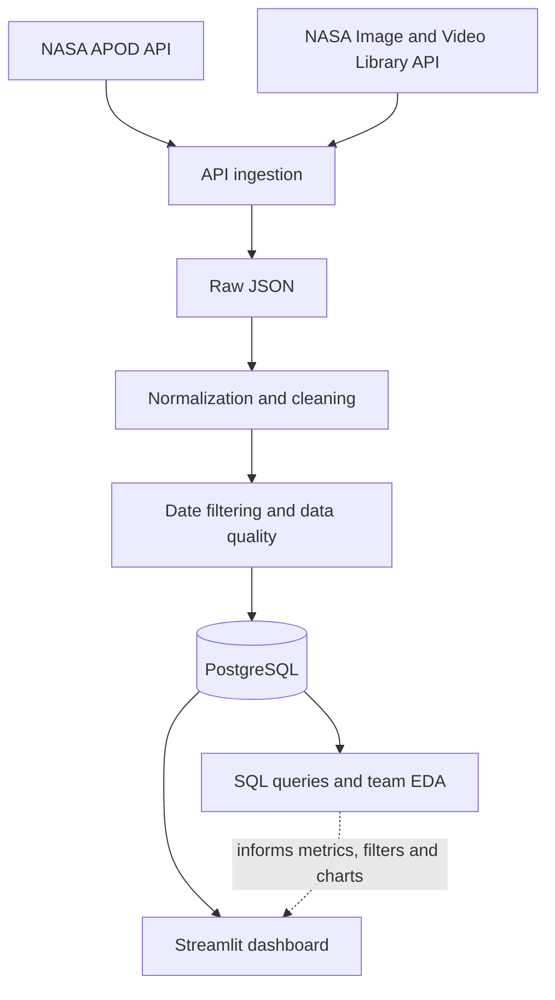

# 🚀 NASA Space Explorer

An end-to-end data engineering pipeline for NASA astronomy media: ingest, clean, validate, store and explore metadata from two public NASA APIs.

**Final group project · Topics in Data Engineering · MS in Machine Learning & Data Science, Northwestern University**

> **Status:** In development. API ingestion, normalization and validation work; PostgreSQL, Airflow, Docker Compose and the Streamlit dashboard are in progress. See [Project status](#project-status).

---

## Contents

- [Overview](#overview)
- [Architecture](#architecture)
- [Quick start](#quick-start)
- [Usage](#usage)
- [Repository structure](#repository-structure)
- [Data model](#data-model)
- [Data quality and testing](#data-quality-and-testing)
- [Project status](#project-status)
- [Team](#team)
- [Contributing](#contributing)
- [Data sources and attribution](#data-sources-and-attribution)

---

## Overview

NASA Space Explorer collects media metadata from two NASA sources, standardizes it into one schema, and makes it explorable through a SQL-backed Streamlit app.

| Source | Endpoint | What we collect |
| --- | --- | --- |
| Astronomy Picture of the Day (APOD) | `https://science.nasa.gov/wp-json/wp/v2/apod-basic` | Daily feature: date, title, explanation, media type, image URL, credit |
| NASA Image and Video Library | `https://images-api.nasa.gov/search` | Images by keyword and year: title, date, description, NASA ID, links, center, location, photographer, keywords |

**Target period:** 2020–2026, subject to data availability.

### Goals

- **Ingest** media metadata from NASA APIs, with retries and pagination
- **Transform** nested JSON into one clean, standardized schema
- **Validate** required fields and dates, and detect duplicates
- **Store** normalized records in PostgreSQL
- **Orchestrate** the pipeline with Apache Airflow
- **Reproduce** the environment with Conda, Docker and Docker Compose
- **Explore** coverage, quality and trends through team EDA
- **Present** findings in an interactive, SQL-backed Streamlit dashboard

---

## Architecture



- **Airflow** orchestrates `fetch → normalize → validate → load`.
- **Docker Compose** runs and connects the pipeline services.
- **The dashboard queries PostgreSQL directly.** EDA notebooks shape its metrics and charts, but are not re-run when a page loads.

### Tech stack

| Category | Tools |
| --- | --- |
| Language | Python 3.11 |
| API and config | `requests`, `python-dotenv` |
| Processing | Python, Pandas |
| Storage | PostgreSQL |
| Orchestration | Apache Airflow |
| Infrastructure | Conda, Docker, Docker Compose |
| Analysis and UI | Jupyter, Plotly, Streamlit |
| Testing | Pytest |

---

## Quick start

### Prerequisites

- Git
- Conda (Anaconda or Miniconda)
- Docker Desktop, for container testing

### Set up

```bash
git clone https://github.com/chirrene/400_Data-engineering_project.git
cd 400_Data-engineering_project

conda env create -f environment.yml
conda activate nasa-space-explorer
python -m pip install -r requirements.txt

cp .env.example .env   # then fill in your local values
```

> **Note:** Work in progress lives on feature branches until it is merged. If a module below is missing, check out the branch that holds it (for example `feature/nasa-apis`).

### Run with Docker

```bash
docker build -t nasa-space-explorer .
docker run --rm nasa-space-explorer
# Expected output: NASA Space Explorer container ready!
```

This only checks that the base image runs. Docker Compose services (PostgreSQL, Airflow, Streamlit) are not wired up yet.

---

## Usage

Run the API clients from the repository root:

```bash
python -m src.apis.apod_client
python -m src.apis.image_library_client
```

Fetch, normalize and validate Image Library results:

```python
from src.apis.image_library_client import fetch_nasa_library_pages
from src.processing.normalize import normalize_nasa_library, filter_records_by_year
from src.processing.validate import validate_record, find_duplicate_records

raw = fetch_nasa_library_pages(query="Mars", max_pages=2, start_year=2020, end_year=2026)

records = normalize_nasa_library(raw)
records = filter_records_by_year(records, 2020, 2026)
valid = [r for r in records if validate_record(r)["is_valid"]]
duplicates = find_duplicate_records(valid)

print(f"Normalized: {len(records)} | Valid: {len(valid)} | Duplicates: {len(duplicates)}")
```

This example does not load data into PostgreSQL or drop duplicates.

### Main functions

| Module | Function | Purpose |
| --- | --- | --- |
| `src/apis/apod_client.py` | `fetch_apod()` | Fetch recent APOD records |
| `src/apis/image_library_client.py` | `create_retry_session()` | Session that retries GET on 429/500/502/503/504, up to 3 times |
| | `fetch_nasa_library(query, page, start_year, end_year)` | Fetch one year-filtered search page |
| | `fetch_nasa_library_pages(query, max_pages, start_year, end_year)` | Combine several search pages |
| `src/processing/normalize.py` | `clean_html(text)` | Strip HTML, decode entities, normalize whitespace |
| | `normalize_apod(record)` | Map an APOD record to the common schema |
| | `normalize_nasa_library(raw_data)` | Flatten Library items into the common schema |
| | `filter_records_by_year(records, start_year, end_year)` | Keep records within a year range |
| `src/processing/validate.py` | `validate_date(date_string)` | Check a `YYYY-MM-DD` date |
| | `validate_record(record)` | Check required fields and date |
| | `find_duplicate_records(records)` | Find repeated `(source_api, source_id)` in one batch |

---

## Repository structure

```text
400_Data-engineering_project/
├── src/
│   ├── apis/              # APOD and Image Library clients
│   ├── processing/        # normalize.py, validate.py
│   ├── database/          # PostgreSQL schema and loading (in progress)
│   └── pipeline/          # Pipeline entry points (in progress)
├── dags/                  # Airflow DAGs
├── sql/                   # Schema and analytical queries
├── notebooks/             # Team EDA
├── pages/                 # Streamlit pages
├── dashboard/             # Dashboard app
├── tests/                 # Pytest suite
├── docs/                  # Project documentation
├── deck/                  # Presentation materials
├── data/                  # Local data only, not committed
├── Dockerfile
├── environment.yml
├── requirements.txt
└── .env.example
```

> **Never commit** `.env`, credentials, generated datasets or cache files.

---

## Data model

APOD and Image Library records share one schema:

| Field | Description |
| --- | --- |
| `source_api` | Which API the record came from |
| `source_id` | ID within the source; with `source_api`, the unique key |
| `date` | `YYYY-MM-DD` (see note below) |
| `title`, `explanation` | Cleaned text |
| `media_type` | Image, video, etc. |
| `image_url`, `page_url`, `asset_manifest_url` | Links to the media and its page |
| `credit`, `alt_text` | Attribution and accessibility text |
| `center`, `location`, `keywords` | Library metadata, often missing |

**Things to know before analyzing:**

- **Same field name, different meaning.** APOD `date` is the day it was featured; Library `date` is `date_created`.
- **Keyword ≠ subject.** A keyword search returns anything tagged or described with that word. For example, 1960s "Saturn" results are mostly Saturn rockets.
- **Library page URLs are built from the NASA ID** and have not been fully link-checked.

---

## Data quality and testing

### Validation rules

- **Required fields:** `source_api`, `source_id`, `title`
- **Date:** parseable `YYYY-MM-DD`
- **Duplicates:** repeated `(source_api, source_id)` within a batch. Across runs, a PostgreSQL unique constraint on the same pair is planned.

### Run the tests

```bash
python -m pytest tests/ -v
```

### Initial results

| Check | Result |
| --- | --- |
| Library retrieval | 100 items per page; 2 pages → 200 normalized records |
| Year filter, 2020–2026 | 200 / 200 in range |
| Required-field and date checks | 200 / 200 passed |
| Within-batch duplicates | 0 |
| Pytest (retry configuration) | 1 passed |
| Docker base image | Starts successfully |

These are component-level checks, not end-to-end tests. Retry recovery, cross-run deduplication, historical APOD retrieval, database loading and Airflow runs still need testing.

---

## Project status

- [x] GitHub repo and feature-branch workflow
- [x] Conda environment
- [x] Docker base image (smoke test)
- [x] APOD client: recent records
- [x] Image Library client: pagination and year filter
- [x] Normalization and basic validation
- [x] Within-batch duplicate detection
- [x] HTTP retry configuration
- [ ] Historical APOD ingestion, 2020–2026
- [ ] PostgreSQL schema, loading and queries
- [ ] Airflow DAG
- [ ] Docker Compose services
- [ ] Team EDA notebooks
- [ ] Streamlit dashboard
- [ ] Expanded tests and end-to-end run

**Historical APOD note:** the `apod-basic` endpoint only honors the `page` parameter (25 posts per page, newest first). Parameters such as `date` and `per_page` are ignored, so 2020–2026 history has to be collected by paging back from the newest posts, about 100 pages.

**Next up:** agree on a data contract for PostgreSQL, expose fetch / normalize / validate to the Airflow DAG, align EDA metrics with the dashboard, and merge the API pull request into `develop`.

---

## Team

| Member | Responsibilities |
| --- | --- |
| Irene | API ingestion, normalization, validation, GitHub coordination, EDA |
| Lize | PostgreSQL schema, data loading, SQL queries, database quality, EDA |
| Andy | Airflow DAG, Docker Compose, workflow automation, pipeline logging, EDA |
| Chloe | Streamlit app, interactive charts and filters, bringing EDA findings into the dashboard |

Everyone shares testing, documentation, code review, design decisions and the final presentation.

---

## Contributing

| Branch | Purpose |
| --- | --- |
| `main` | Stable version |
| `develop` | Integration branch |
| `feature/*` | One workstream each, branched from `develop` |

1. Branch from `develop`: `git checkout -b feature/<name> develop`
2. Commit, push, and open a pull request into `develop`
3. Merge after review

---

## Data sources and attribution

- [NASA Astronomy Picture of the Day (APOD)](https://apod.nasa.gov/apod/)
- [NASA Image and Video Library](https://images.nasa.gov/) · [API docs](https://images.nasa.gov/docs/images.nasa.gov_api_docs.pdf)
- [Apache Airflow](https://airflow.apache.org/) · [Docker](https://docs.docker.com/) · [Streamlit](https://docs.streamlit.io/) · [Plotly](https://plotly.com/python/)

**Image rights:** Many APOD images belong to third-party photographers, not NASA. Always show the `credit` field with an image, and don't assume an image is public domain.

Results describe the data this project collected through specific queries, not NASA's entire archive.
